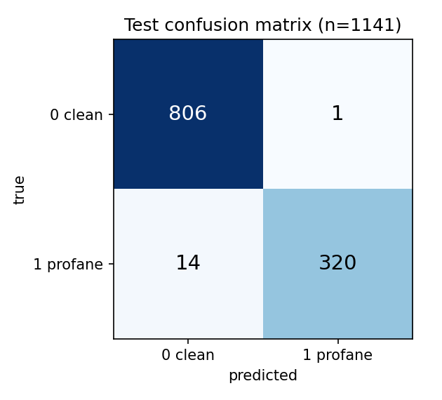

# Kazakh Profanity Detection

DSSC5113 bonus project (KBTU, Fall 2026). An individual project by Nurasyl Sakayev.

The model reads one Kazakh product review or comment and returns:

* **label** `0` = no profanity, `1` = profanity present
* **probability** of class 1, and the decision **threshold** that was tuned on validation data

```
$ python -m kzprofanity.predict "Тауар өте нашар, ақша босқа кетті" "Қ*тақ бас сатушы"
0 clean    p=0.002 (threshold 0.273) | Тауар өте нашар, ақша босқа кетті
1 PROFANE  p=0.989 (threshold 0.273) | Қ*тақ бас сатушы
```

> **Labels used for the results below:** automatic lexicon labels plus **45 manual labels** (all 16 rows
> where the decision was unclear, and 29 more ambiguous rows). The remaining 267 ambiguous rows are left out, not guessed (see §4).

---

## Main notebook: everything in one place

**[`notebooks/kazakh_profanity.ipynb`](notebooks/kazakh_profanity.ipynb)**: load data → clean → normalise → label → split →
features → train with validation grid search → threshold → test (confusion matrix, PR and ROC curves) → interpretation →
errors → challenge set → save model → predict your own comment. **Run all** takes about 1-2 minutes, locally (`pip install jupyter`) or in
a fresh Google Colab runtime (the first cell clones the repo). It is saved with its outputs, so all plots can be read on GitHub
without running it.

The same pipeline also exists as scripts in `kzprofanity/` (below). Both give identical results: the last notebook cell checks that its
confusion matrix equals the one from `python -m kzprofanity.evaluate`.

## 1. Quick start

```bash
git clone https://github.com/DzoTo/DL-bonus-task.git && cd DL-bonus-task
python -m venv .venv
.venv\Scripts\activate            # Windows  (Linux/Mac: source .venv/bin/activate)
pip install -r requirements.txt

# use the saved model, no retraining needed
python -m kzprofanity.predict "Тауар өте нашар"
python -m kzprofanity.predict "Тауар өте нашар" --explain    # trace: text -> n-grams -> probability -> label
python -m kzprofanity.predict --interactive                  # type your own comments
python -m kzprofanity.predict --file my.csv --out preds.csv  # CSV with a "text" column
```

From Python:

```python
from kzprofanity.predict import predict
predict("Бұл тауар өте нашар")   # {'text': ..., 'label': 0, 'probability': 0.0005, 'threshold': 0.27}
```

The trained model is `models/model.joblib` (0.6 MB). It is committed to the repository and holds the
fitted TF-IDF vocabulary, the classifier, the threshold and the settings. Nothing else is needed for
inference.

## 2. Reproduce everything with scripts (about 1 minute on a laptop)

```bash
python -m kzprofanity.prepare_data   # download KazSAnDRA, scrub personal data, dedupe, pre-label
python -m kzprofanity.make_splits    # apply manual labels, group near-duplicates, 70/15/15 split
python -m kzprofanity.train          # grid search on validation, pick threshold, save model
python -m kzprofanity.evaluate       # single test evaluation -> results/
python -m pytest -q                  # 160+ checks: lexicon rules, normalisation, PII, predict()
```

All settings are in [`config.yaml`](config.yaml): seed `42`, split ratios, sample sizes, the
n-gram/C grid and the threshold strategy. Package versions are pinned in `requirements.txt`
(Python 3.10).

## 3. Task definition and labeling rules

*Swear words in this README are partly masked with `*`; the data itself is not masked.*

**1 = the comment contains profanity (мат)**, Kazakh or Russian, in any spelling. **0 = everything else**,
including very negative or rude reviews.

| Case | Rule | Example → label |
|---|---|---|
| Kazakh obscene words | 1 | `қ*тақбас ойын` → 1, `шешеңнің *мы` → 1, `с*гейін` → 1 |
| Mixed language | KazSAnDRA comments are code-switched Kazakh/Russian. Russian мат *inside a Kazakh comment* counts as profanity, because readers see it the same way. | `ойын п*здец екен` → 1 |
| Masked words | A mask (`*`, `#`, `@`, digits) that hides a letter of a profane word still counts. | `б*ять`, `к0т*к`, `с*#ейын` → 1 |
| Spelling variants | Latin script, look-alike letters, repeated letters and spaced letters all count. | `q*taq`, `c*ka`, `к*таааак`, `с у * а` → 1 |
| Negative but clean | Anger, complaints and low ratings are **not** profanity. | `Тауар өте нашар, ақша босқа кетті` → 0 |
| Insults that are not мат | Rude, but not obscene. | `ақымақ`, `есек`, `оңбаған`, `мал`, `дебил`, `идиот` → 0 |
| Innocent look-alikes | Same letters, different word. | `көтеру`, `адам`, `аман`, `қатынас`, `педиатр`, `сукно`, `бильярд` → 0 |
| Borderline vulgar words | `жопа, хер, қатын, жезөкше, боқ, говно, сайқал, долбан`: **decided per comment** by a human. Default 1 if used as swearing, 0 if used literally. | `қатын` (wife, literal) → 0 |
| Ambiguous / typos | Decided by a human. Typos that only *look* profane are 0. | `сіге` (typo of `сізге`) → 0, `қаямын` (typo of `қоямын`) → 0 |

Labeled examples from the dataset:

| Comment (from KazSAnDRA) | Label | Why |
|---|---|---|
| `Қ*тағымды жегер ойын мынау` | 1 | Kazakh obscene word with a suffix |
| `Сөз жоқ п*здес приложение` | 1 | Russian мат in a Kazakh sentence |
| `Шшс п*дц кызык ойын` | 1 | abbreviations of obscene phrases |
| `Шешең аман болсын осы, ойынды шығарған адам` | 0 | "may your mother be well": `шешең` + `аман` is not `шешең *мы` |
| `Мен мына ақымақтарға айтайын ойнай алмасаңдар...` | 0 | insult, not obscene |
| `Тез желінеді баллон, не стоит, качество так себе` | 0 | negative review, clean |

## 4. Dataset

**Source:** [KazSAnDRA](https://github.com/IS2AI/KazSAnDRA) (ISSAI, Nazarbayev University, CC BY 4.0).
It contains 175,158 real Kazakh reviews from app stores, online markets (`market`), maps and bookstores, with
1-5 star ratings. The rows are reviews of products, apps and services, so the data matches the task domain.
`prepare_data.py` downloads the score files `06_sc_train_ib`, `09_sc_valid` and `10_sc_test` automatically.

**Its labels do not fit this task.** KazSAnDRA is labeled for *sentiment*, and a 1-star review is not
profane. The star ratings were ignored. Every row in this project got a new profanity label:

```
KazSAnDRA 175,158 reviews
  │  scrub personal data (URL/e-mail/phone/@user -> tags)          406 rows changed
  │  remove duplicates (same letters after normalisation)       -12,010
  ▼  162,989 unique reviews
  │  scan with the lexicon (kzprofanity/lexicon.py, 45 rules)
  ├── strong hit (unambiguous мат)            -> label 1 automatically           2,241
  ├── only ambiguous/borderline hit           -> MANUAL label                      312
  ├── no hit, contains a non-obscene insult   -> label 0 (hard negative)           378
  ├── no hit, 1-2 stars (angry)               -> label 0, random 2,500
  ├── no hit, 3-5 stars                       -> label 0, random 2,500
  └── audit: 30 random auto-1 + 30 random auto-0 -> queued for manual check (not labeled yet, see §8)
```

The lexicon only *finds candidates*. It is **not** the classifier and **not** a model feature. It was
built from my own list of Kazakh swear words, extended with variants found in the corpus. Its
**148 self-tests** (`python -m kzprofanity.lexicon`) cover each rule and the innocent look-alikes.
I checked random samples of every rule by hand. Several rules were narrowed after the checks
because they caught typos (`сіге`, `сиқты`, `қаямын`, `сігіспей`) or innocent words (`бильярд`,
`шешең аман`, `ámın` = "amen").

**Synthetic data:** none in train, validation or test. The only synthetic file is
`data/challenge/challenge.csv`: 40 sentences I wrote to stress-test masks, spelling variants and
look-alikes. It is reported separately and never used for training or model selection.

**Total: 7,664 labeled comments**: 5,387 clean (70.3%) and 2,277 profane (29.7%).

**Splits** (seed 42, stratified by label × manual/automatic):

| split | rows | label 0 (clean) | label 1 (profane) |
|---|---|---|---|
| train | 5,364 | 3,771 | 1,593 |
| validation | 1,150 | 806 | 344 |
| test | 1,150 | 810 | 340 |

Label sources: 2,241 lexicon (strong hit) · 2,500 random clean · 2,500 clean 1-2★ (angry) · 378 hard negatives
(insult but not мат) · **45 manual** (36 profane, 9 clean; my decisions on ambiguous rows). The full numbers are in `data/splits/split_stats.json`.

* **Duplicates** are removed before splitting. Two comments count as duplicates if they have the same letters after
  `canonical()`, so case, punctuation, emoji and repeated letters are ignored.
* **Near-duplicates** (the same *set* of words, e.g. `керемет ойын` / `ойын керемет керемет`) form a
  group, and the whole group goes to one split. `make_splits.py` asserts that no text or word set occurs
  in two splits.
* **Vocabulary** (TF-IDF) is fitted on the training split only, inside the sklearn `Pipeline`.

**Personal data.** The repository does **not** contain comment texts. `data/raw`, `data/interim` and
`data/processed` are git-ignored and rebuilt by the scripts. What is committed is
`data/splits/split_ids.csv` (id, label, split) and `data/labeling/manual_labels.csv` (id, label, note),
which are enough to rebuild the exact dataset from KazSAnDRA. Links, e-mails, phone numbers and @usernames
are replaced with `<URL>`, `<EMAIL>`, `<PHONE>` and `<USER>` before anything is saved. Comment examples in this
README were picked so that they contain no names.

## 5. Model

**TF-IDF over character n-grams + Logistic Regression** (`kzprofanity/model.py`). The reasons for this choice:

* **Kazakh is agglutinative.** `сатушы`, `сатушылар`, `сатушының` and `сатушыларға` share the root's n-grams, so
  unseen suffixes still score high. A word-level model would treat each form as a new word.
* **Spelling noise is the norm.** Masks, Latin letters and typos change one or two characters, and most n-grams survive.
* **No unknown-token problem.** Any new word is split into n-grams, and n-grams that were never seen in
  training simply get no weight.
* **Explainable.** Each prediction is a sum of `tfidf(n-gram) × weight` (see `--explain`). That's the
  "trace one comment" defense question. Trains in 2 s, model is 0.6 MB.
* A fine-tuned transformer (e.g. `xlm-roberta-base`) might handle context better. But it needs a GPU and is
  much harder to trace, and the task asks for one well-understood model.

**How text becomes model input:**

1. `canonical()` (`kzprofanity/text.py`): lowercase → Kazakh Latin and Latin→Cyrillic (`q→к`, `sh→ш`) →
   digits/symbols inside words (`0→о`, `@→а`, `#→*`) → `қ→к, і→и, ң→н, ө→о, ұ/ү→у, ә→а, ғ→г, щ→ш`, drop `ь/ъ`
   → glue spaced letters (`с у п е р→супер`) → punctuation and emoji → space (`*` is kept as a mask
   signal) → collapse repeats (`жаааман→жаман`). These are fixed rules with nothing learned, so there is no leakage.
2. `TfidfVectorizer(analyzer="char_wb", ngram_range=(2,5), min_df=2, sublinear_tf=True)`. `char_wb` means the
   n-grams stay inside words (padded with spaces).
3. `LogisticRegression(C=100, class_weight="balanced", solver="liblinear")`. The objective is L2-regularised
   log-loss, with class weights for the 70/30 imbalance.

**Long comments:** there is no truncation, because the whole comment becomes one vector. The side effect is that TF-IDF
L2-normalisation *dilutes* one swear word in a long comment (see errors below).
**Punctuation:** removed, except `*`. **Repeated punctuation and emoji:** removed.

**Training-time augmentation** (`augment_mask_frac: 0.3`): 30% of training rows *of each class* get a
copy where some inner letters are replaced by `*`. This teaches that `б**ть` ≈ `бл*ть`. Both classes are
masked, so `*` alone does not mean "profane". It is applied to the training split only.

**Model selection (validation only):** grid `C ∈ {0.1, 1, 10, 30, 100}` × n-grams `{(1,3), (2,5), (3,6)}`.
The best pair by validation F1 was chosen, with ties broken by average precision. The **threshold** is the one that maximises F1 on
validation (`results/val_search.csv`, `results/train_summary.json`).

## 6. Results (test set, evaluated once)

| | precision | recall | F1 | TP | FP | FN | TN |
|---|---|---|---|---|---|---|---|
| **model (test)** | **0.974** | **0.988** | **0.981** | 336 | 9 | 4 | 801 |
| lexicon only (test) | 1.000 | 0.985 | 0.993 | 335 | 0 | 5 | 810 |
| always 0 (test) | 0.000 | 0.000 | 0.000 | 0 | 0 | 340 | 810 |
| model (challenge set) | 1.000 | 0.750 | 0.857 | 15 | 0 | 5 | 20 |
| lexicon only (challenge set) | 1.000 | 0.850 | 0.919 | 17 | 0 | 3 | 20 |

n_test = **1,150** (340 profane), threshold **0.272** (chosen on validation), ROC-AUC 0.9995, average precision 0.9988.
Confusion matrix: `results/confusion_matrix.png`; PR curve: `results/pr_curve.png`;
all predictions (ids only): `results/test_predictions.csv`; errors with text: `results/errors.csv` (created locally by `evaluate`, git-ignored); predictions on the challenge set: `results/challenge.csv`; most important n-grams: `results/top_ngrams.csv`.
More plots (validation grid, threshold curve, ROC, n-gram weights, a traced prediction) are in `notebooks/kazakh_profanity.ipynb`.



**How to read the baselines.** "Lexicon only" scores 0.993 on test *largely by construction*: most test labels were
produced by the same lexicon. It is not perfect only because of the **manually labeled rows**: on those, it misses
5 profane comments that the model catches. That is why the lexicon only proposes labels and a trained model does the classification.
The test set mostly measures how well the model *reproduces* the labeling procedure; the manual rows, the challenge set and the
error analysis show how it *generalises*. On the 7 manual rows in test the model gets 6 right (`results/metrics.json` → `by_label_source`).

**False positive vs false negative in moderation:**

* **FP** (clean comment flagged): a customer's legitimate, possibly angry, opinion is hidden. This is unfair to
  the customer and to the seller's reputation. It is costly if comments are auto-deleted.
* **FN** (profanity published): an obscene comment is shown to all buyers, which hurts the platform.
* For a store, a sensible setup is **auto-hide at high probability and send the middle band to a human**.
  If comments are only hidden pending review, recall matters more, so set `threshold.strategy: min_recall` in
  `config.yaml`.

## 7. Error analysis

The model makes **13 mistakes on 1,150 test comments: 4 FN and 9 FP** (`results/errors.csv`, created locally).
All of them were read by hand. They fall into four groups:

1. **The label is wrong, and the model is right (2 of 13).** Both are labeled 0 (clean) but are actually profane:
   `Корона вирус к*тынды қысып сен отыр…` is an obscene phrase spelled with `ы` (`көтіңді`), which no lexicon rule
   covers, and `Е Байт күшті қой` is the profane interjection `Ебайт` split by a space. The model flags both.
   *Reason:* lexicon labels are noisy. *Improvement:* manually review the rows where the model disagrees with the label, and add
   lexicon rules for these spellings.
2. **Innocent words containing "profane" n-grams (5 of 13, all FP).** `d*lbasalap` ("flailing about", p = 0.77) shares `д*лб`
   with a common insult; `АЛЛАХУ АКБАР АМИН` (p = 0.67) contains `ху` and `ам`; `халява` (p = 0.34) and `балшыққа белшесімен`
   (p = 0.52) share pieces with swear words; and `… 5 жұлдыз қой ам.` (p = 0.60), which I labeled 0 by hand because `ам` is a
   particle here. *Reason:* character n-grams see pieces of words, not their meaning. *Improvement:* more clean training
   examples containing these pieces (hard negatives), and a word-level feature next to the character n-grams.
3. **One swear word diluted in a longer comment (3 of 13, all FN).** E.g. an 18-word complaint with one masked `х*я`
   (p = 0.25), and `ЖАМАН` repeated eight times before one glued `КАГ*НДОН` (p = 0.26). Missed profanity is in comments with
   a median of **16 words**, compared with **5 words** for caught profanity. *Reason:* TF-IDF L2-normalisation spreads the
   weight over all n-grams, so one strong word among many clean ones gets a low score. *Improvement:* score each sentence (or
   a window of about 5 words) separately and flag the comment if any part is profane.
4. **Close to the threshold (3 of 13).** `Х*евая игра` (FN, p = 0.24 vs threshold 0.27), a one-word complaint (FP, p = 0.27),
   and a rude comment with a 🖕 emoji but no мат (FP, p = 0.41). *Reason:* any threshold leaves borderline cases on both sides.
   *Improvement:* send comments with p between about 0.2 and 0.6 to a human moderator.

**Challenge set** (40 hand-written sentences, `results/challenge.csv`): the model gets all 20 clean sentences right, including
look-alikes like `көтерме`, `педиатр`, `шешен сөйлейді` and insults like `ақымақ`, `дебил`. It misses 5 of the 20 profane ones:
double masks (`б**ть`, `х*йня`), a new spelling (`Зайыбал`), and the Kazakh words `қ*ншық` and `ж*леп`, which are almost
absent from the training data. The lexicon scores higher here (F1 0.92 vs 0.86), because it contains those exact words. The
model's advantage is that it generalises to forms nobody wrote a rule for (group 1 above, and the 5 manual rows the lexicon misses).

**What the errors mean for moderation.** The threshold chosen on validation (0.27) favours recall: 98.8% of profane comments
are caught, at the cost of 9 of 810 clean comments being flagged (precision 0.974). For a store this is the right direction:
publishing мат is usually worse than sending a clean review to a moderator. A real system would add the per-sentence scoring
from point 3 and a human-review band for uncertain scores.

## 8. Limitations

* Most positive labels come from a lexicon, so test metrics are optimistic (see §6). Only 45 of the 312 ambiguous rows were
  labeled by hand, and the 60 audit rows were not labeled, so the noise of the automatic labels is not measured.
  The manual labels and the challenge set are the honest measurements.
* The lexicon reflects my knowledge of Kazakh/Russian slang. Rare regional words are missing, and so are words
  written in a way that no rule normalises (`пидоp` with a Latin `p` becomes `пидоп`).
* The domain is mostly app-store reviews (about 85% of test). There is little data from `market`, the closest domain to
  "product reviews".
* `canonical()` maps `қ→к`, `і→и` and so on, so a few Kazakh/Russian word pairs become identical (`көт`/`кот`).
* During development, test errors were inspected to find **labeling** bugs in the lexicon (e.g. `шешең аман`
  "may your mother be well", `ámın` "amen", `бильярд` were wrongly labeled 1 and were fixed with self-tests).
  Model settings and the threshold were never tuned on the test set; they come from validation only.

## 9. Repository layout

```
kzprofanity/        package: text.py (normalisation, PII), lexicon.py, prepare_data.py, make_splits.py,
                    model.py, train.py, evaluate.py, predict.py, config.py
config.yaml         every setting + seed
data/challenge/     40 hand-written stress-test sentences (synthetic, not used for training)
data/labeling/      manual_labels.csv (committed); to_review.csv (local, git-ignored)
data/splits/        split_ids.csv + split_stats.json (committed, no text)
models/model.joblib trained model (vectorizer + classifier + threshold)
results/            metrics, confusion matrix, PR curve, predictions, errors, top n-grams
tests/              pytest suite
notebooks/          kazakh_profanity.ipynb: the whole pipeline in one notebook, with plots
```

## 10. AI assistance and my contribution

AI tools were allowed for this project. I used an AI coding assistant (a large language model): it wrote most of
the Python code, the regex patterns for the lexicon and the drafts of this README, following my instructions.

**My own work:**
* the initial list of Kazakh swear words and the decision to count Russian мат in Kazakh comments
* the labeling rules (§3) and 45 manual labels (`data/labeling/manual_labels.csv`), including every row where the decision was unclear
* checking the lexicon samples, and choosing what counts as borderline
* reviewing and running all code, the final evaluation, and the error analysis

I can explain every step of the pipeline at the defense.

## References

* Yeshpanov, R., Varol, H. A. *KazSAnDRA: Kazakh Sentiment Analysis Dataset of Reviews and Attitudes*. LREC-COLING 2024. Dataset: <https://github.com/IS2AI/KazSAnDRA> (CC BY 4.0).
* scikit-learn: `TfidfVectorizer`, `LogisticRegression`.
